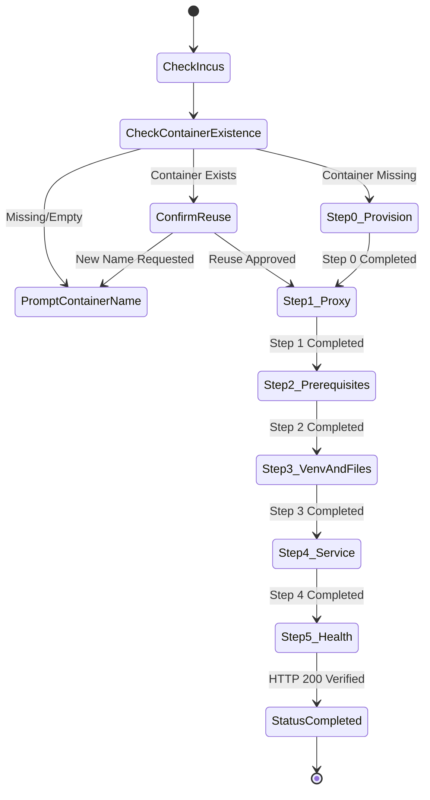

# Data Model & State Schema: Deployment Script Hardening & Container Lifecycle

**Feature**: `004-enhance-deployment-script`
**Date**: 2026-11-05

## Entities & State Definitions

### 1. Deployment Execution Context (In-Memory Runtime Session)
Represents the runtime configuration derived from CLI flags, environment variables, and interactive inputs.

| Field | Type | Description | Default / Source |
|---|---|---|---|
| `REPO_ROOT` | String (Path) | Absolute path to repository root | Dynamically resolved via `dirname` |
| `INCUS_BIN` | String | Path or binary name for Incus | `incus` |
| `CONTAINER_NAME` | String | Target Incus container name | Interactive input or CLI argument |
| `CONTAINER_EXISTS` | Boolean (0/1) | Whether container was already present in Incus | `incus info "${CONTAINER_NAME}"` |
| `DEBIAN_IMAGE` | String | Base image alias/fingerprint | `images:debian/13` (fallback `images:debian/stable`) |
| `HOST_PORT` | Integer | Host port exposed for Web UI | `8080` (overridable via `--port`) |
| `OLLAMA_TARGET` | String | Target host/IP:port for Ollama proxy | Auto-discovered or prompt/`--ollama-url` |
| `APP_DIR` | String (Path) | Application root directory inside container | `/opt/e-webui` |
| `VENV_DIR` | String (Path) | Virtual environment directory in container | `/opt/e-webui/venv` |
| `STATE_FILE` | String (Path) | State persistence file inside container | `/opt/e-webui/.deploy_state` |
| `NON_INTERACTIVE`| Boolean (0/1) | Whether auto-confirming prompts | `0` (overridable via `-y`/`--yes`) |
| `FORCE_RESET` | Boolean (0/1) | Whether resetting saved progress | `0` (overridable via `-r`/`--force`) |

---

### 2. Deployment Step State Record (`.deploy_state`)
Stored as key-value pairs formatted as `<STEP_KEY>=<ISO-8601-UTC-TIMESTAMP>` inside the container at `/opt/e-webui/.deploy_state`.

#### Step Keys Lifecycle:
```text
STEP_0_CONTAINER_PROVISIONED=YYYY-MM-DDTHH:MM:SSZ
STEP_1_PROXY_CONFIGURED=YYYY-MM-DDTHH:MM:SSZ
STEP_2_PREREQUISITES_INSTALLED=YYYY-MM-DDTHH:MM:SSZ
STEP_3_VENV_AND_FILES_SYNCED=YYYY-MM-DDTHH:MM:SSZ
STEP_4_SERVICE_CONFIGURED=YYYY-MM-DDTHH:MM:SSZ
STEP_5_HEALTH_VERIFIED=YYYY-MM-DDTHH:MM:SSZ
STATUS_COMPLETED=YYYY-MM-DDTHH:MM:SSZ
```

#### State Transitions:


---

### 3. Step Definition Schema

Each step in the deployment script is structured with:
- `step_num`: Integer (e.g. 0 to 5)
- `total_steps`: Integer (6 total steps: 0 through 5)
- `step_key`: Unique string identifier matching `.deploy_state`
- `step_title`: Short human-readable title
- `step_description`: Detailed explanation shown to the user before confirmation
- `action`: Bash function executing the step payload with strict error checking
- `validation`: Verification logic ensuring the step succeeded before writing state
