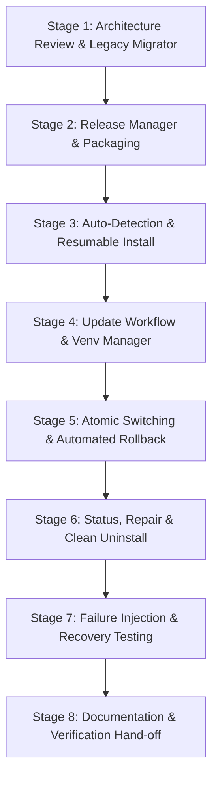

# Implementation Plan: Deployment Lifecycle Manager

**Branch**: `008-deployment-lifecycle-manager` | **Date**: 2026-11-06 | **Spec**: [specs/008-deployment-lifecycle-manager/spec.md](file:///home/ellie/Documents/Projects/e-webui/specs/008-deployment-lifecycle-manager/spec.md)

**Input**: Feature specification from `specs/008-deployment-lifecycle-manager/spec.md`

---

## Summary

Redesign `deploy.sh` and introduce a modular deployment management framework under `scripts/lib/` for e-webui running in Incus containers. The solution transitions the deployment model from a destructive single-folder overwrite to an atomic, release-based architecture with independent virtual environment caching, automated rollback, persistent data protection, and legacy migration.

---

## Technical Context

**Language/Version**: Bash (Strict Mode `set -euo pipefail`) for host and container orchestration; Python 3.11+ for application runtime and local test harnesses.  
**Primary Dependencies**: Incus (host container runtime), systemd (container PID 1 service manager), uvicorn/FastAPI (application runtime), standard POSIX utilities (`tar`, `sha256sum`, `awk`, `curl`).  
**Storage**: Container filesystem at `/opt/e-webui/` partitioned into `releases/`, `venvs/`, `shared/` (`.env` and persistent `data/`), `staging/`, and `.deploy_state` JSON.  
**Testing**: `pytest` test suite with mocked Incus runner CLI (`tests/test_deploy_lifecycle.py`), executing locally within workspace without live container access.  
**Target Platform**: Linux host with Incus; Debian stable container instance.  
**Project Type**: CLI deployment tool and orchestration scripts.  
**Performance Goals**: Routine updates complete in < 15 seconds; automatic rollback completes in < 10 seconds; 0 OS package reinstalls or container deletions during updates.  
**Constraints**: Strict compliance with Constitution Principle I (Infrastructure Isolation) — no direct execution of live `incus` commands by the AI assistant.  
**Scale/Scope**: Manages standalone container deployments for single-instance e-webui environments.

---

## Constitution Check

*GATE: Must pass before Phase 0 research. Re-check after Phase 1 design.*

| Principle | Compliance Status | Analysis & Verification |
|---|---|---|
| **Principle I: Infrastructure Isolation** | **PASS** | The agent will author scripts and test them strictly with local mock harnesses (`pytest`). Real Incus operations are exclusively performed by the human operator. |
| **Principle II: Workspace-Only Scope** | **PASS** | All source code, modular libraries, tests, and documentation are authored strictly inside the repository directory (`scripts/`, `tests/`, `specs/`). |
| **Principle III: Transparent Delegation** | **PASS** | Clear CLI commands, operator runbooks, and validation scenarios are documented in `quickstart.md` for manual execution. |

*Post-Design Evaluation*: Architecture introduces zero host mounts, zero container-level backdoor accesses, and zero bypassing of user-supervised execution boundaries.

---

## Project Structure

### Documentation (this feature)

```text
specs/008-deployment-lifecycle-manager/
├── plan.md              # Implementation plan (this file)
├── research.md          # Phase 0 architectural decisions
├── data-model.md        # Phase 1 storage layout & entities
├── quickstart.md        # Phase 1 validation scenarios
├── contracts/           # Phase 1 contracts
│   ├── cli-interface.md
│   ├── systemd-service.md
│   └── deploy-state-schema.json
└── tasks.md             # Phase 2 task breakdown (/speckit-tasks output)
```

### Source Code Layout

```text
e-webui/
├── deploy.sh                     # Root wrapper (forwards to scripts/deploy.sh)
├── scripts/
│   ├── deploy.sh                 # Main CLI entry point & workflow orchestrator
│   └── lib/
│       ├── common.sh             # Logging, formatting, and exit trap helpers
│       ├── lock.sh               # Container-level exclusive concurrency lock
│       ├── incus.sh              # Wrapped Incus CLI runner (mock-aware)
│       ├── detect.sh             # Environment, ownership, and legacy state detection
│       ├── archive.sh            # Host packaging, exclusion filtering & SHA-256 verification
│       ├── venv.sh               # Requirements hashing, venv discovery & pip caching
│       ├── service.sh            # Systemd unit generation, installation & restart
│       ├── health.sh             # HTTP health polling & journal diagnostic capture
│       ├── rollback.sh           # Automatic failure recovery & manual --rollback
│       └── migrate.sh            # Legacy flat deployment migration
├── app/
│   ├── main.py                   # FastAPI entry point
│   ├── config.py                 # Configuration loader
│   └── systemd/
│       └── e-webui.service       # Service unit template
└── tests/
    ├── conftest.py
    ├── mock_incus.py             # Mock Incus CLI stub for test isolation
    └── test_deploy_lifecycle.py  # Unit & contract tests for deployment logic
```

---

## Phased Implementation Roadmap

The implementation is structured into 8 modular stages following the user's recommended sequence to minimize risk and allow incremental validation:



### Stage 1: Legacy Architecture Review & Migration Helper (`migrate.sh`, `detect.sh`)
- Implement legacy layout detection (detects `STEP_*` in `.deploy_state` and unversioned `/opt/e-webui/`).
- Build migration logic: non-destructively convert flat files to `releases/legacy-initial/` and `venvs/`, preserving existing virtualenvs and database files without container recreation.

### Stage 2: Release Manager & Host Archive Packaging (`archive.sh`, `lock.sh`)
- Implement container-level exclusive locking (`.deploy.lock`) with cleanup traps.
- Implement host tarball packager excluding `.git/`, `.env`, host venvs, and documentation.
- Implement host and container SHA-256 checksum calculation and integrity validation.

### Stage 3: Auto-Detection & Resumable Installation (`scripts/deploy.sh`, `incus.sh`)
- Refactor top-level CLI argument parsing (`--install`, `--update`, `--rollback`, etc.).
- Implement environment auto-detection (missing container -> install; managed container -> update; unmanaged container -> explicit prompt).
- Implement initial provisioning with Debian stable container launch and Incus proxy device setup.

### Stage 4: Update Workflow & Python Dependency Manager (`venv.sh`)
- Implement SHA-256 calculation for `requirements.txt`.
- Implement virtual environment reuse when hash matches existing `/opt/e-webui/venvs/<hash>`.
- Implement new isolated virtual environment creation when dependencies change.
- Symlink `releases/<id>/venv -> venvs/<hash>` and `releases/<id>/data -> shared/data`.

### Stage 5: Atomic Release Switching & Rollback Engine (`rollback.sh`, `health.sh`)
- Implement atomic directory symlink swap (`mv -Tf current_next current`).
- Implement HTTP readiness verification (`GET /api/health`) with retries.
- Implement automatic rollback trigger on startup/health timeout: swap symlink to `previous_healthy_release`, restart service, and capture journal logs.
- Implement explicit manual `--rollback`.

### Stage 6: Day-2 Operations: Status, Repair & Clean Uninstall (`service.sh`)
- Implement `--status`: print container state, active release, previous release, venv hash, and HTTP health.
- Implement `--repair`: restore broken symlinks, re-align systemd service, reload daemon.
- Implement `--uninstall`: cleanly stop service, remove proxies and unit; preserve `shared/` data unless `--purge-data` is specified.

### Stage 7: Failure Testing & Local Mock Validation (`tests/test_deploy_lifecycle.py`)
- Author local test suite using mock Incus runner:
  - Test archive exclusion rules.
  - Test venv hashing and reuse.
  - Test atomic switching and rollback on simulated health timeout.
  - Test legacy migration detection.
  - Test locking and collision handling.

### Stage 8: Documentation & Verification Hand-off
- Update root `README.md` and `scripts/` documentation with new CLI flags.
- Finalize Spec-Kit artifacts and provide clear verification hand-off instructions to the operator.

---

## Complexity Tracking

*No constitutional violations; no additional complexity exceptions required.*
