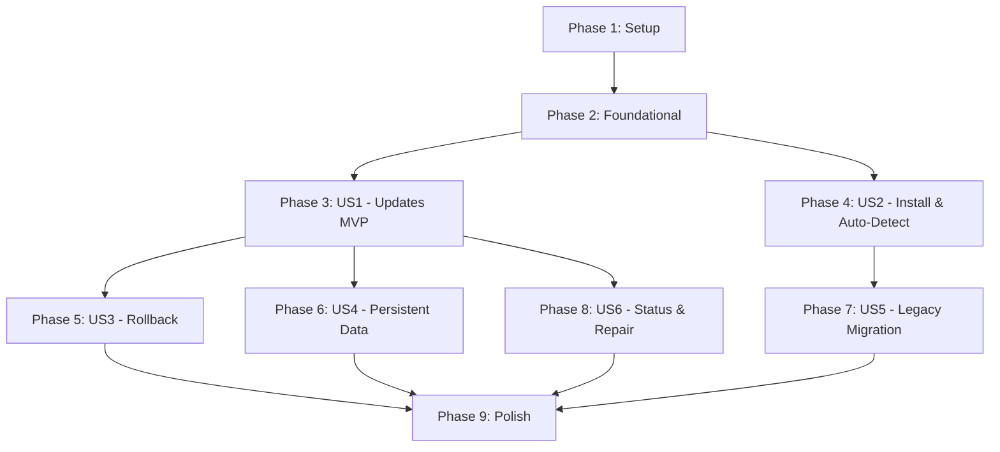

# Tasks: Deployment Lifecycle Manager

**Input**: Design documents from `specs/008-deployment-lifecycle-manager/`  
**Prerequisites**: `plan.md`, `spec.md`, `research.md`, `data-model.md`, `contracts/`, `quickstart.md`  

---

## Phase 1: Setup (Shared Infrastructure)

**Purpose**: Project initialization, module directory scaffolding, and local mock testing setup.

- [X] T001 Create modular directory structure `scripts/lib/` and test scaffolding in `tests/` per implementation plan
- [X] T002 [P] Setup local mock Incus test harness and fixture in `tests/mock_incus.py` to intercept and validate Incus CLI interactions without live container calls
- [X] T003 [P] Implement shared utility and logging module in `scripts/lib/common.sh` with standardized logging functions, color handling, and exit trap registration

---

## Phase 2: Foundational (Blocking Prerequisites)

**Purpose**: Core infrastructure that MUST be complete before ANY user story can be implemented.

- [X] T004 Implement container command executor and Incus CLI wrapper in `scripts/lib/incus.sh` supporting both live execution and test mock interception
- [X] T005 [P] Implement exclusive container deployment lock in `scripts/lib/lock.sh` (`acquire_lock`, `release_lock` using atomic `/opt/e-webui/.deploy.lock` and trap handlers)
- [X] T006 [P] Implement deployment state schema and JSON state manager in `scripts/lib/state.sh` adhering to `specs/008-deployment-lifecycle-manager/contracts/deploy-state-schema.json`
- [X] T007 Implement systemd unit generator and installer in `scripts/lib/service.sh` adhering to `specs/008-deployment-lifecycle-manager/contracts/systemd-service.md` (`WorkingDirectory=/opt/e-webui/current`, `ExecStart=/opt/e-webui/current/venv/bin/uvicorn app.main:app`)
- [X] T008 [P] Implement HTTP readiness polling and journal log diagnostic capture in `scripts/lib/health.sh` targeting `http://127.0.0.1:8080/api/health`

**Checkpoint**: Core foundation ready — User story implementation can now begin.

---

## Phase 3: User Story 1 - Fast and Safe Application Updates (Priority: P1) 🎯 MVP

**Goal**: Roll out application code updates in < 15 seconds without container recreations, reusing virtualenvs when dependencies are unchanged, and atomically swapping the `current` release pointer.

**Independent Test**: Execute `./deploy.sh --update <container>` on an existing release: confirm zero container restarts, unchanged dependencies skip pip install, archive is extracted to `releases/<id>`, `current` is atomically swapped via `mv -Tf`, and service returns HTTP 200.

- [X] T009 [P] [US1] Author unit and integration tests for release packaging, checksum calculation, and atomic switching in `tests/test_deploy_lifecycle.py`
- [X] T010 [P] [US1] Implement host-side release archiver in `scripts/lib/archive.sh` excluding `.git/`, `.env*`, `venv/`, `__pycache__/`, `specs/`, and calculating SHA-256 checksum
- [X] T011 [P] [US1] Implement Python dependency manager in `scripts/lib/venv.sh` calculating SHA-256 of `requirements.txt`, discovering matching venvs in `/opt/e-webui/venvs/<hash>`, and creating new venvs only on hash mismatches
- [X] T012 [US1] Implement container staging, archive extraction, and symlink creation (`releases/<id>/venv` and `releases/<id>/data`) in `scripts/lib/release.sh`
- [X] T013 [US1] Implement atomic symlink switch (`ln -sfn releases/<id> current_next && mv -Tf current_next current`) in `scripts/lib/release.sh`
- [X] T014 [US1] Implement core update workflow function `run_update()` in `scripts/deploy.sh` chaining lock, packaging, transfer, venv resolution, atomic switch, service restart, and health verification

**Checkpoint**: User Story 1 is functional and verifiable as a standalone MVP update pipeline.

---

## Phase 4: User Story 2 - Automated Environment Detection & Resumable Initial Installation (Priority: P1)

**Goal**: Automatically detect uninstalled or clean environments and guide container launch, OS initialization, dependency installation, proxy device binding, and first release setup.

**Independent Test**: Execute `./deploy.sh <new-container>`: verify Debian container launch, proxy device creation (`webui-proxy`, `ollama-link`), directory hierarchy creation, initial venv setup, and recording of the first healthy release.

- [X] T015 [P] [US2] Author unit tests for environment detection and initial provisioning in `tests/test_deploy_lifecycle.py`
- [X] T016 [P] [US2] Implement deployment environment detector in `scripts/lib/detect.sh` identifying container presence, running status, managed ownership markers, and legacy layouts
- [X] T017 [US2] Implement container provisioning and Incus proxy device setup (`webui-proxy` on host port and `ollama-link` on port 11434) in `scripts/lib/provision.sh`
- [X] T018 [US2] Implement OS prerequisite installation (`python3`, `python3-pip`, `python3-venv`, `curl`) and directory layout setup (`releases/`, `venvs/`, `shared/`) in `scripts/lib/provision.sh`
- [X] T019 [US2] Implement initial installation workflow `run_install()` in `scripts/deploy.sh` integrating provisioning, first release packaging, systemd registration, and initial `.deploy_state` initialization
- [X] T020 [US2] Implement top-level auto-detection logic in `scripts/deploy.sh` dispatching to `run_install()`, `run_update()`, or prompting on unmanaged containers

**Checkpoint**: User Stories 1 and 2 work independently: clean install bootstraps releases, and update rolls out changes.

---

## Phase 5: User Story 3 - Automatic and Manual Rollback on Health Failure (Priority: P2)

**Goal**: Automatically restore the previous healthy release pointer within 10 seconds if a new release fails startup or HTTP health checks, and provide an explicit `--rollback` command.

**Independent Test**: Deploy a release with an invalid entry point: observe health timeout, automatic symlink reversal to `previous_healthy_release`, service restart, successful HTTP 200 on restored release, non-zero script exit code, and preservation of failed release in `releases/`.

- [X] T021 [P] [US3] Author tests for automatic failure recovery, manual rollback, and diagnostic log capture in `tests/test_deploy_lifecycle.py`
- [X] T022 [US3] Implement rollback engine in `scripts/lib/rollback.sh` retrieving `previous_healthy_release` from `.deploy_state`, swapping `current`, restarting service, and confirming health
- [X] T023 [US3] Implement failure trigger in `scripts/deploy.sh` intercepting health check failures during update, dumping journal logs, and executing automatic rollback
- [X] T024 [US3] Implement CLI subcommand `--rollback` in `scripts/deploy.sh` for manual operator-triggered rollback

**Checkpoint**: System self-heals on broken releases and provides manual rollback capabilities.

---

## Phase 6: User Story 4 - Persistent Data and Configuration Preservation (Priority: P2)

**Goal**: Isolate `.env`, databases, and user uploads in `/opt/e-webui/shared/` so that routine updates, rollbacks, and clean uninstalls never destroy persistent user data.

**Independent Test**: Create custom values in `shared/.env` and dummy data in `shared/data/`: execute multiple updates and a rollback, confirming files remain untouched and properly linked from the active release.

- [X] T025 [P] [US4] Author tests verifying exclusion of secrets from archives and persistence of `shared/` directory in `tests/test_deploy_lifecycle.py`
- [X] T026 [US4] Implement shared data initialization and symlink binding (`releases/<id>/data -> shared/data`) in `scripts/lib/release.sh`
- [X] T027 [US4] Configure `EnvironmentFile` bindings (`deployment.env` and `shared/.env`) in `scripts/lib/service.sh`
- [X] T028 [US4] Implement clean uninstall workflow `run_uninstall()` in `scripts/deploy.sh` removing service and proxies while preserving `shared/` by default (only deleting `shared/` when `--purge-data` is passed)

**Checkpoint**: Persistent user configuration and data remain completely independent of release lifecycles.

---

## Phase 7: User Story 5 - Legacy Deployment Migration (Priority: P3)

**Goal**: Automatically detect existing legacy deployments (`STEP_*` state file and flat `/opt/e-webui/`) and migrate them into the release-based structure without container recreation or OS reinstall.

**Independent Test**: Construct a mock legacy container environment: run `./deploy.sh`: confirm legacy state detection, migration of existing code into `releases/legacy-initial/`, venv migration to `venvs/`, atomic `current` pointer creation, systemd unit update, and successful health check.

- [X] T029 [P] [US5] Author unit tests for legacy state detection and migration workflows in `tests/test_deploy_lifecycle.py`
- [X] T030 [US5] Implement legacy migration engine in `scripts/lib/migrate.sh` converting flat app directories, moving existing venvs to `venvs/`, establishing `releases/legacy-initial/`, and converting `.deploy_state` to JSON format
- [X] T031 [US5] Integrate legacy migration into `scripts/deploy.sh` auto-detection workflow

**Checkpoint**: Existing single-folder deployments upgrade in-place without data loss or OS reinstall.

---

## Phase 8: User Story 6 - Observability, Status Inspection, and Repair (Priority: P3)

**Goal**: Provide day-2 operations commands (`--status`, `--repair`, `--help`) to inspect container state, diagnose broken symlinks, and restore consistent service configurations.

**Independent Test**: Break the `current` symlink intentionally: run `./deploy.sh --repair`: verify restoration of symlinks, systemd unit verification, daemon reload, and healthy status output via `./deploy.sh --status`.

- [X] T032 [P] [US6] Author tests for status reporting and repair diagnostics in `tests/test_deploy_lifecycle.py`
- [X] T033 [US6] Implement `--status` command in `scripts/deploy.sh` formatting container state, active release ID, venv hash, service status, and HTTP health
- [X] T034 [US6] Implement `--repair` command in `scripts/deploy.sh` inspecting filesystem pointers, regenerating missing symlinks, re-aligning systemd unit, and restarting service
- [X] T035 [US6] Implement comprehensive usage documentation in `scripts/deploy.sh` (`--help`, exit code reference, compatible options `-p`, `-o`, `-y`, `-r`)

**Checkpoint**: All operational day-2 commands and diagnostic tools are fully implemented.

---

## Phase 9: Polish & Cross-Cutting Concerns

**Purpose**: Final integration, documentation, and compliance verification across all components.

- [X] T036 [P] Update root `deploy.sh` wrapper and synchronize CLI argument forwarding to `scripts/deploy.sh`
- [X] T037 [P] Update `README.md` and project documentation with new CLI subcommands, release structure diagrams, and operational guides
- [X] T038 Run full local test suite `pytest tests/test_deploy_lifecycle.py` and verify all tests pass
- [X] T039 Conduct Constitution Principle I compliance review to guarantee zero live Incus commands or unprivileged sandbox escapes exist in scripts or tests

---

## Dependencies & Execution Order

### Phase Dependencies

### Parallel Opportunities

- **Phase 1**: T002 and T003 can execute in parallel.
- **Phase 2**: T005, T006, and T008 can execute in parallel once T004 is defined.
- **User Story 1 (MVP)**: T009, T010, and T011 can execute in parallel.
- **User Story 2**: T015 and T016 can execute in parallel.
- **User Story 3**: T021 can run in parallel with earlier test development.
- **User Story 4**: T025 can run in parallel.
- **User Story 5**: T029 can run in parallel.
- **User Story 6**: T032 can run in parallel.
- **Phase 9**: T036 and T037 can execute in parallel.

---

## Implementation Strategy

### MVP First (User Story 1 Focus)
1. Complete Phase 1 (Setup) and Phase 2 (Foundational).
2. Complete Phase 3 (User Story 1 - Fast Application Updates).
3. **Validate MVP**: Run tests in `tests/test_deploy_lifecycle.py` to prove isolated release packaging, venv reuse, and atomic symlink swapping work end-to-end.

### Incremental Feature Expansion
1. Deliver Phase 4 (Auto-Detection & Initial Install) to provide full bootstrapping.
2. Deliver Phase 5 (Automatic & Manual Rollback) to ensure zero-downtime resilience.
3. Deliver Phase 6 (Persistent Data Protection) and Phase 7 (Legacy Migration).
4. Deliver Phase 8 (Status, Repair, Help) and Phase 9 (Polish & Audit).
