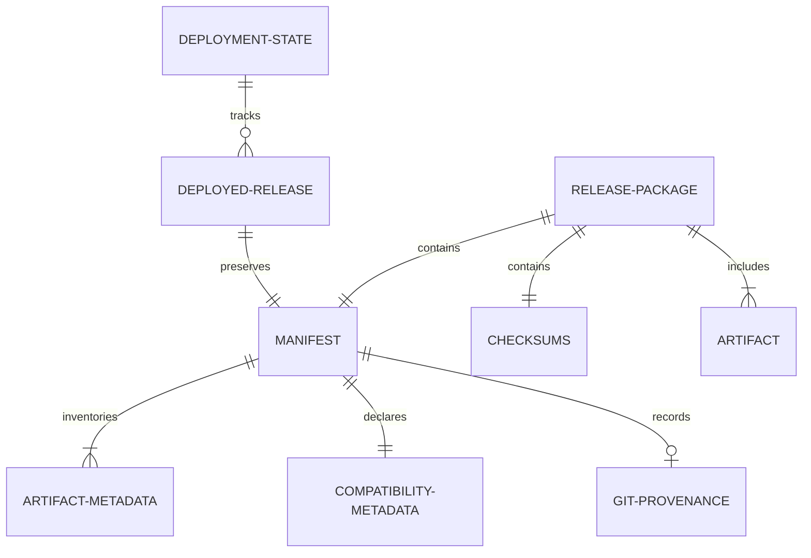

# Data Model: Release Artifact Specification & Packaging System

**Feature**: `009-release-artifact-packaging`  
**Date**: 2026-11-06  
**Status**: Completed  

---

## 1. Entities Overview



---

## 2. Entity Definitions

### 1. `ReleasePackage`
Represents the physical distributable bundle (either directory or compressed `.tar.gz`).

| Field | Type | Required | Description |
|-------|------|----------|-------------|
| `path` | Path | Yes | Local filesystem path to release package. |
| `format` | Enum (`bundle_archive`, `directory`) | Yes | Distribution format. |
| `manifest` | `Manifest` | Yes | Parsed and validated release manifest object. |
| `checksums` | `Checksums` | Yes | List of verified cryptographic hashes. |
| `payload` | `Payload` | Yes | Contained runtime deployment assets. |

### 2. `Manifest`
The canonical machine-readable metadata file (`manifest.json`).

| Field | Type | Validation / Constraints | Description |
|-------|------|--------------------------|-------------|
| `schema_version` | String | SemVer format `MAJOR.MINOR.PATCH` (e.g. `"1.0.0"`) | Version of the manifest schema. |
| `application` | String | Must equal `"e-webui"` | Application identifier. |
| `version` | String | SemVer format (e.g. `"1.0.0"`) | Semantic version of the application code. |
| `release_id` | String | Format `YYYYMMDD-HHMMSS-<SHORT_COMMIT>` | Unique build instance identifier. |
| `created_at` | String | ISO 8601 UTC timestamp (`YYYY-MM-DDTHH:MM:SSZ`) | Moment release was packaged. |
| `git` | Object | Optional / Nullable commit, branch, dirty boolean | Git source provenance. |
| `compatibility` | Object | Required min manager & python versions | Compatibility constraints. |
| `artifacts` | List[`ArtifactMetadata`] | Minimum 3 items (`app_source`, `dependencies`, `service_unit`) | Complete inventory of packaged files. |
| `metadata` | Object | Optional builder info, notes | Extensible freeform metadata. |

### 3. `ArtifactMetadata`
Entry in `manifest.json` describing an individual deployable asset.

| Field | Type | Constraints | Description |
|-------|------|-------------|-------------|
| `name` | String | Basename (e.g. `"app.tar.gz"`) | Human-readable artifact name. |
| `path` | String | Relative path under release root (e.g. `"payload/app.tar.gz"`) | Relative file path. |
| `sha256` | String | 64 hexadecimal characters lowercase | SHA-256 digest of the artifact file. |
| `size_bytes` | Integer | >= 0 | Exact file size in bytes. |
| `purpose` | Enum | `app_source`, `dependencies`, `service_unit`, `verification` | Functional purpose for Deployment Manager. |

### 4. `GitProvenance`
Records source repository state at build time.

| Field | Type | Constraints | Description |
|-------|------|-------------|-------------|
| `commit` | String / Null | 40 hex chars or short sha | Commit SHA at build time. |
| `branch` | String / Null | String | Git branch name. |
| `dirty` | Boolean | True if uncommitted changes existed | Working tree cleanliness. |

### 5. `CompatibilityMetadata`
Guarantees consumer-producer alignment.

| Field | Type | Constraints | Description |
|-------|------|-------------|-------------|
| `min_deployment_manager_version` | String | SemVer (e.g. `"1.0.0"`) | Minimum `deploy.sh` version required. |
| `python_version` | String | Version constraint (e.g. `">=3.11"`) | Python runtime compatibility. |
| `target_os` | String | Optional (e.g. `"debian-12"`) | Target operating system distribution. |

### 6. `Checksums`
Parsed representation of `checksums.sha256`.

| Field | Type | Description |
|-------|------|-------------|
| `entries` | Map[RelativePath, Sha256Hash] | Map of relative paths to expected SHA-256 hashes. |

---

## 3. State Transitions & Lifecycle

### Packaging Lifecycle (Release Builder)
```text
[Start]
  │
  ▼
[Create /tmp Staging]
  │
  ▼
[Allowlist Filter & Tar app/ -> payload/app.tar.gz]
  │
  ▼
[Copy requirements.txt -> payload/requirements.txt]
  │
  ▼
[Copy systemd unit -> payload/systemd/e-webui.service]
  │
  ▼
[Compute SHA-256 & Sizes for all payload items]
  │
  ▼
[Generate manifest.json & checksums.sha256]
  │
  ▼
[Pre-publication Self-Verification (schema + sha256sum)]
  │
  ├── Failure ──► [Cleanup /tmp Staging & Exit Non-zero]
  │
  ▼ Success
[Atomic Move to dist/releases/<release-id> & Tarball bundle]
  │
  ▼
[Cleanup /tmp Staging & Output Success]
```

### Deployment Lifecycle (`deploy.sh`)
```text
[Locate Release Package]
  │
  ▼
[Host Pre-Flight Validation (Schema + Hashes)]
  │
  ├── Failure ──► [Abort Deployment, Active Release Untouched]
  │
  ▼ Pass
[Acquire Container Lock]
  │
  ▼
[Transfer Package to /opt/e-webui/staging/]
  │
  ▼
[Container Pre-Extraction Validation (sha256sum -c + Path Safety Audit)]
  │
  ├── Failure ──► [Clean Staging, Release Lock, Abort Deployment]
  │
  ▼ Pass
[Extract to /opt/e-webui/releases/<release-id>/]
  │
  ▼
[Cache/Link Virtualenv (/opt/e-webui/venvs/<req_hash>)]
  │
  ▼
[Link Persistent Data (/opt/e-webui/shared/data)]
  │
  ▼
[Atomic Pointer Switch (/opt/e-webui/current)]
  │
  ▼
[Restart Service & Probe /api/health]
  │
  ├── Failure ──► [Automatic Rollback to previous_healthy_release]
  │
  ▼ Pass
[Commit Metadata to .deploy_state & Release Lock]
```
