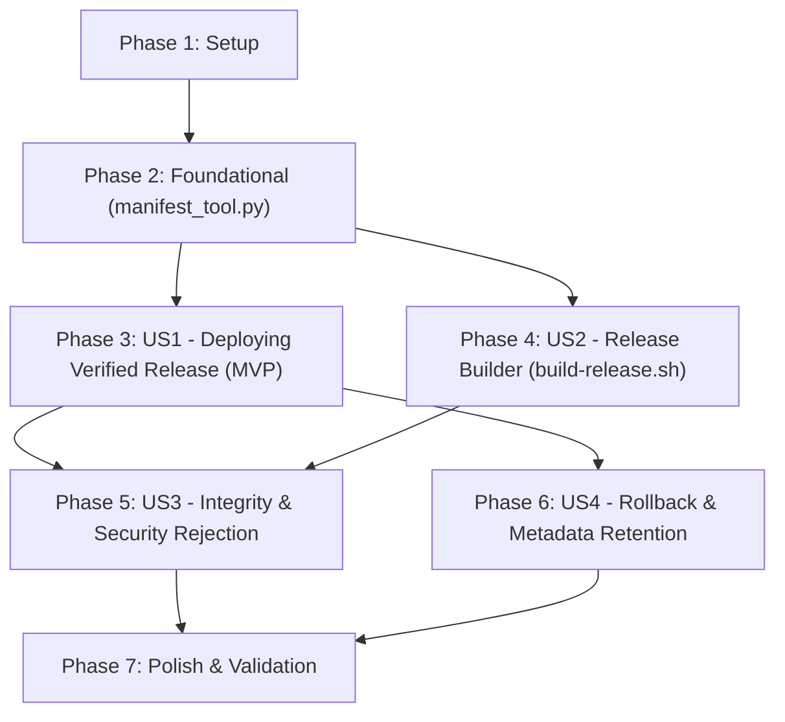

# Tasks: Release Artifact Specification and Packaging System

**Input**: Design documents from `/specs/009-release-artifact-packaging/` (`spec.md`, `plan.md`, `research.md`, `data-model.md`, `contracts/`, `quickstart.md`)  
**Prerequisites**: `plan.md`, `spec.md`, `data-model.md`, `contracts/`  
**Constitution**: Strict adherence to Principle I (Infrastructure Isolation) — all automated verification runs locally via unit tests and mock Incus harnesses.  

## Format: `- [ ] [TaskID] [P?] [Story?] Description with file path`

- **[P]**: Can run in parallel (different files, no dependencies)
- **[Story]**: Which user story this task belongs to (e.g., [US1], [US2], [US3], [US4])
- File paths are exact repository-relative paths

---

## Phase 1: Setup (Shared Infrastructure)

**Purpose**: Establish schema definitions, canonical templates, and directory structures for release artifacts.

- [X] T001 [P] Create manifest schema definition in `specs/009-release-artifact-packaging/contracts/manifest-schema.json` and ensure `.gitignore` ignores `dist/` build output
- [X] T002 [P] Update canonical systemd service unit template to reference `/opt/e-webui/current` and environment files in `app/systemd/e-webui.service`
- [X] T003 [P] Create unit test scaffold for manifest and builder tests in `tests/unit/test_manifest_tool.py`

---

## Phase 2: Foundational (Blocking Prerequisites)

**Purpose**: Core Python manifest utility and schema validator that MUST be complete before release builder and deployment consumer can operate.

**⚠️ CRITICAL**: All user stories depend on `manifest_tool.py` for JSON schema validation, checksum verification, and archive security audits.

- [X] T004 Implement `manifest_tool.py` CLI utility with standard library `argparse`, `json`, `hashlib`, `tarfile`, and `pathlib` in `scripts/lib/manifest_tool.py`
- [X] T005 Implement `validate-manifest` command with strict schema validation conforming to `contracts/manifest-schema.json` in `scripts/lib/manifest_tool.py`
- [X] T006 Implement `verify-checksums` command verifying `checksums.sha256` against disk files in `scripts/lib/manifest_tool.py`
- [X] T007 Implement `verify-archive` security audit detecting absolute paths, directory traversal (`..`), and escaping symlinks in `scripts/lib/manifest_tool.py`
- [X] T008 [P] Add unit tests for manifest creation, schema validation, and path traversal rejection in `tests/unit/test_manifest_tool.py`

**Checkpoint**: Foundation ready — release packaging and deployment consumption workflows can now be implemented.

---

## Phase 3: User Story 1 - Deploying a Verified Release Package (Priority: P1) 🎯 MVP

**Goal**: Enable `deploy.sh` to discover, validate, transfer, extract, and activate a pre-packaged release bundle without inspecting host source files.

**Independent Test**: Build a release package, run `./deploy.sh --update --release dist/releases/<release-package>`, and verify that `deploy.sh` verifies checksums, provisions the release in the container, and verifies health without touching host source files.

### Tests for User Story 1
- [X] T009 [P] [US1] Add test for `--release <path>` CLI parsing and latest release auto-discovery in `tests/test_deploy_lifecycle.py`
- [X] T010 [P] [US1] Add test for deploying a valid release package via mock Incus harness in `tests/test_deploy_lifecycle.py`

### Implementation for User Story 1
- [X] T011 [US1] Add `--release <PATH>` option and auto-discovery of latest package in `dist/releases/` to `scripts/deploy.sh`
- [X] T012 [US1] Implement host pre-flight verification function (`verify_release_package_on_host`) in `scripts/lib/archive.sh` using `scripts/lib/manifest_tool.py`
- [X] T013 [US1] Refactor `scripts/lib/archive.sh` to remove `build_release_archive` from the deployment path, replacing it with release bundle unpacking/staging
- [X] T014 [US1] Update `extract_release_in_container` in `scripts/lib/release.sh` to extract `payload/app.tar.gz`, stage `payload/requirements.txt`, and copy `manifest.json` and `checksums.sha256` into `/opt/e-webui/releases/<release-id>/`
- [X] T015 [US1] Update `run_update` and `run_install` in `scripts/deploy.sh` to consume pre-built releases instead of packaging `${REPO_ROOT}` on the fly
- [X] T016 [US1] Update status command in `scripts/lib/diagnostics.sh` and `scripts/lib/state.sh` to display application version, release ID, build timestamp, and Git commit SHA from `manifest.json`

**Checkpoint**: At this point, User Story 1 provides a functional MVP: `deploy.sh` consumes pre-packaged release packages.

---

## Phase 4: User Story 2 - Automated and Reproducible Release Packaging (Priority: P1)

**Goal**: Provide a dedicated `scripts/build-release.sh` command that packages application code, enforces strict exclusions, computes SHA-256 digests, and publishes atomic release bundles.

**Independent Test**: Run `./scripts/build-release.sh`, verify the output in `dist/releases/`, inspect `payload/app.tar.gz` to ensure zero secrets or dev files are present, and verify `checksums.sha256` passes 100%.

### Tests for User Story 2
- [X] T017 [P] [US2] Add unit tests for `build-release.sh` verify exclusion of `.git`, `.env`, `venv`, `tests/`, and `__pycache__` in `tests/unit/test_release_builder.py`
- [X] T018 [P] [US2] Add unit tests for atomic release publication and cleanup on failure in `tests/unit/test_release_builder.py`

### Implementation for User Story 2
- [X] T019 [US2] Implement `manifest_tool.py create-manifest` command generating `manifest.json` and `checksums.sha256` from staged payload in `scripts/lib/manifest_tool.py`
- [X] T020 [US2] Implement packaging helper library `scripts/lib/builder.sh` handling staging directory creation, allowlist archiving (`app/`, `requirements.txt`, `app/systemd/e-webui.service`), permissions normalization (`0755`/`0644`), and atomic publication to `dist/releases/`
- [X] T021 [US2] Implement top-level CLI script `scripts/build-release.sh` with options `--output-dir`, `--version`, `--strict`, `--archive-only`, `--dir-only`, and `-h/--help`
- [X] T022 [US2] Create root convenience wrapper `build-release.sh` delegating to `scripts/build-release.sh`
- [X] T023 [US2] Add dirty git state detection in `scripts/lib/builder.sh` (flagging `"git": {"dirty": true}` and appending `-dirty` suffix to `release_id` unless `--strict` fails)

**Checkpoint**: At this point, User Stories 1 and 2 form a complete build-and-deploy loop: `build-release.sh` produces verified packages and `deploy.sh` consumes them.

---

## Phase 5: User Story 3 - Pre-Flight Rejection of Corrupt or Malicious Releases (Priority: P2)

**Goal**: Ensure `deploy.sh` detects tampered artifacts, schema mismatches, missing files, and directory traversal sequences before any container modification.

**Independent Test**: Attempt deployment of: (a) a tampered file, (b) an archive containing `../` paths, and (c) an incompatible schema version: verify deployment halts immediately with error code 2/3 and active container state is untouched.

### Tests for User Story 3
- [X] T024 [P] [US3] Add test for pre-flight rejection of tampered checksums in `tests/test_deploy_lifecycle.py`
- [X] T025 [P] [US3] Add test for rejection of archives with path traversal or absolute member paths in `tests/test_deploy_lifecycle.py`
- [X] T026 [P] [US3] Add test for rejection of unsupported manifest schema versions (e.g., `2.0.0`) in `tests/test_deploy_lifecycle.py`

### Implementation for User Story 3
- [X] T027 [US3] Implement container-side staging verification (`verify_archive_in_container` using `manifest_tool.py verify-archive` and `verify-checksums`) in `scripts/lib/archive.sh`
- [X] T028 [US3] Implement fail-safe staging cleanup traps in `scripts/deploy.sh` ensuring rejected staging artifacts in `/opt/e-webui/staging/` are immediately removed
- [X] T029 [US3] Implement structured actionable error diagnostics for invalid releases (identifying exact failed file, expected vs actual SHA-256, or schema violation) in `scripts/lib/common.sh` and `scripts/lib/archive.sh`

**Checkpoint**: At this point, the deployment process is hardened against corrupt, tampered, or hostile packages.

---

## Phase 6: User Story 4 - Seamless Rollback and History Retention (Priority: P2)

**Goal**: Retain release manifests and checksums in `/opt/e-webui/releases/<release-id>/` across updates and rollbacks, updating persistent state metadata accurately.

**Independent Test**: Deploy release A, deploy failing release B, trigger automatic rollback, and verify that `/opt/e-webui/.deploy_state` and `./deploy.sh --status` reflect release A's manifest metadata.

### Tests for User Story 4
- [X] T030 [P] [US4] Add test verifying `manifest.json` persistence in release directory and status reporting in `tests/test_deploy_lifecycle.py`
- [X] T031 [P] [US4] Add test verifying automatic rollback restores manifest metadata in `.deploy_state` in `tests/test_deploy_lifecycle.py`

### Implementation for User Story 4
- [X] T032 [US4] Update `state_commit_release` in `scripts/lib/state.sh` to record `active_version`, `git_commit`, and `release_id` from the release manifest into `/opt/e-webui/.deploy_state`
- [X] T033 [US4] Update `trigger_rollback` in `scripts/lib/rollback.sh` to read `manifest.json` from the fallback release and restore metadata in `/opt/e-webui/.deploy_state`
- [X] T034 [US4] Update `prune_old_releases` in `scripts/lib/release.sh` to retain `manifest.json` and `checksums.sha256` alongside preserved release directories

**Checkpoint**: Full release lifecycle, history auditing, and rollback provenance are completely operational.

---

## Phase 7: Polish & Cross-Cutting Concerns

**Purpose**: Documentation updates, verification runs, and final cleanup.

- [X] T035 [P] Update `README.md` with instructions for `build-release.sh` and `./deploy.sh --release <path>`
- [X] T036 Run quickstart validation scenarios from `specs/009-release-artifact-packaging/quickstart.md`
- [X] T037 Execute full test suite `pytest tests/unit/ tests/test_deploy_lifecycle.py -v` and verify 100% pass rate

---

## Dependencies & Execution Order

### Phase Dependencies

- **Setup (Phase 1)**: Can start immediately.
- **Foundational (Phase 2)**: Depends on Phase 1. Blocks all user stories because `manifest_tool.py` is required by both builder and deployment consumer.
- **User Story 1 (Phase 3)**: Implements consumer side (`deploy.sh --release`).
- **User Story 2 (Phase 4)**: Implements producer side (`build-release.sh`). Can be developed in parallel with US1 once Foundational is complete.
- **User Story 3 (Phase 5)**: Hardens integrity checks and rejection gates across producer and consumer.
- **User Story 4 (Phase 6)**: Extends rollback and state persistence with manifest metadata.
- **Polish (Phase 7)**: Depends on all user stories being complete.

---

## Parallel Opportunities

- **Phase 1**: T001, T002, T003 can all run in parallel.
- **Phase 2**: T008 (scaffold tests) can run alongside T005, T006, T007.
- **Phase 3**: Tests T009 and T010 can be written in parallel before implementation.
- **Phase 4**: Tests T017 and T018 can run in parallel; T020 and T021 can be implemented after T019.
- **Phase 5**: Tests T024, T025, T026 can be written in parallel.
- **Phase 6**: Tests T030 and T031 can be written in parallel.

---

## Implementation Strategy

### MVP First (User Story 1 Only)
1. Complete Phase 1: Setup.
2. Complete Phase 2: Foundational (`manifest_tool.py`).
3. Complete Phase 3: User Story 1 (`deploy.sh --release`).
4. **STOP and VALIDATE**: Verify that `deploy.sh` can deploy a pre-staged release package via `tests/test_deploy_lifecycle.py`.

### Incremental Delivery
1. Foundation: Complete `manifest_tool.py`.
2. Increment 1: User Story 1 (`deploy.sh` becomes a release consumer).
3. Increment 2: User Story 2 (`build-release.sh` produces atomic packages).
4. Increment 3: User Story 3 (Security hardening & traversal prevention).
5. Increment 4: User Story 4 (Rollback & metadata persistence).
6. Polish: Documentation and end-to-end quickstart validation.
