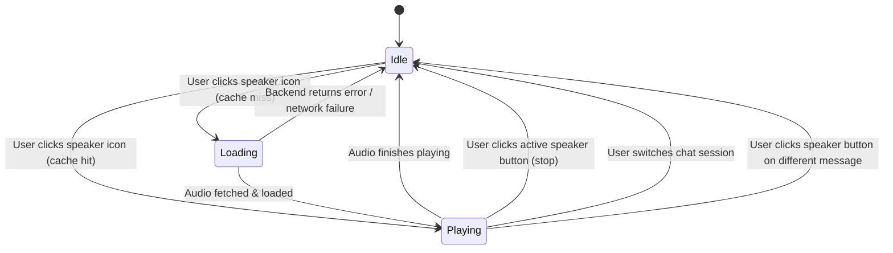

# Data Model: Read Aloud TTS for Assistant Replies

**Branch**: `015-read-aloud` | **Date**: 2026-11-07 | **Spec**: [spec.md](spec.md)

This document defines the data structures, entities, and state models used across the backend and frontend for the speech synthesis feature.

---

## 1. Backend Data Models

### 1.1 `TTSRequest` (Pydantic Model)
Represents the incoming payload for a speech synthesis request.

| Field | Type | Validation / Constraints | Description |
|---|---|---|---|
| `text` | `str` | `min_length=1`, `max_length=3000` | The raw text of the assistant response to synthesize. |
| `message_id` | `Optional[str]` | `max_length=64`, default `None` | Optional client-assigned message identifier for tracking and correlation. |

```python
class TTSRequest(BaseModel):
    text: str = Field(
        ...,
        min_length=1,
        max_length=3000,
        description="Assistant reply text to read aloud (max 3,000 characters).",
    )
    message_id: Optional[str] = Field(
        default=None,
        max_length=64,
        description="Optional client message ID for request tracking.",
    )
```

### 1.2 `CleanedText` (Internal Data Structure)
Represents the normalized text ready for speech synthesis.

| Field | Type | Description |
|---|---|---|
| `raw_text` | `str` | Original raw response text. |
| `clean_text` | `str` | Normalized prose after stripping code blocks, markdown syntax, links, and emojis. |
| `has_speakable_content` | `bool` | True if at least one alphabetic character remains in `clean_text`. |
| `char_count` | `int` | Length of `clean_text`. |

### 1.3 `TTSAudioPayload` (Binary Audio Response)
Binary audio payload returned by the synthesis engine.

| Attribute | Value / Format | Description |
|---|---|---|
| `media_type` | `audio/wav` | Standard PCM audio container. |
| `sample_rate` | `24000` | Kokoro native output sampling frequency in Hz. |
| `bit_depth` | `16-bit signed PCM` | Standard linear PCM formatting. |
| `channels` | `1 (Mono)` | Single-channel speech waveform. |
| `content` | `bytes` | Binary WAV byte sequence starting with `RIFF...WAVEfmt `. |

### 1.4 `TTSEngineState` (Backend Singleton State)
Tracks in-process model lifecycle status.

| Attribute | Type | Description |
|---|---|---|
| `available` | `bool` | True if Kokoro library, PyTorch CPU, and model weights are verified. |
| `initialized` | `bool` | True if `KPipeline` has been lazily loaded into memory. |
| `model_dir` | `Path` | Root directory containing model weights and voice files. |
| `weights_path` | `Optional[Path]` | Resolved path to `kokoro-v1_0.pth` or `kokoro-v0_19.pth`. |
| `error_reason` | `Optional[str]` | Human-readable error message if initialization or discovery failed. |

---

## 2. Frontend State Models

### 2.1 `TTSPlaybackState`
Represents the current state of speech synthesis and playback in the browser.

```typescript
type PlaybackState = 'idle' | 'loading' | 'playing';
```

| State | Visual Indicator | Available User Action |
|---|---|---|
| `idle` | Neutral speaker icon button | Click to request synthesis and start audio |
| `loading` | Pulsing / spinning speaker icon | Disabled or click ignored (debounced) |
| `playing` | Active sound-waves speaker icon | Click to stop playback immediately |

### 2.2 `TTSClientState` (In-Memory Controller State)
Managed by the singleton `TTSController` in `app/static/js/tts.js`.

| Property | Type | Description |
|---|---|---|
| `activeAudio` | `HTMLAudioElement \| null` | Single active browser audio element. |
| `activeMessageId` | `string \| null` | ID of the message currently loading or playing. |
| `currentState` | `PlaybackState` | Current state of active playback. |
| `cache` | `Map<string, string>` | In-memory cache mapping `messageId` to generated Object URL (`blob:http:...`). |
| `lastError` | `string \| null` | Unobtrusive error message if last request failed. |

### 2.3 Audio Lifecycle & State Transitions


