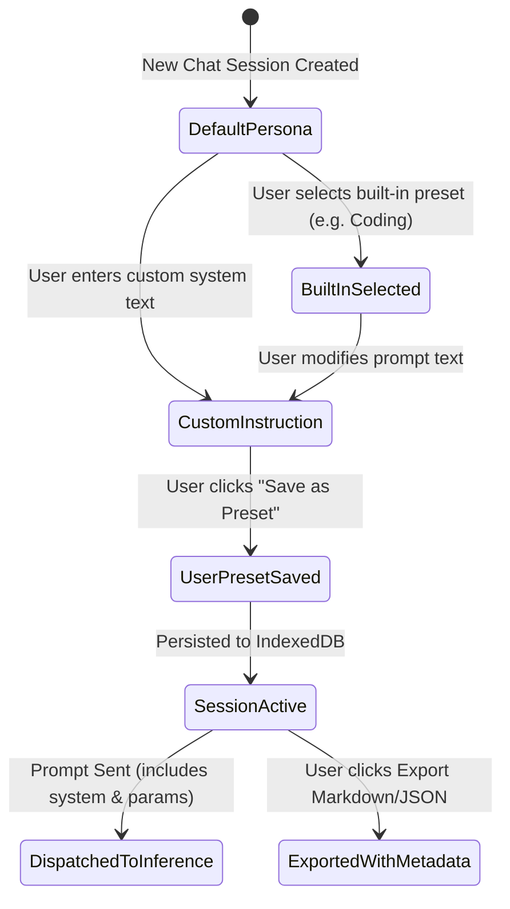

# Phase 1 Data Model: System Prompt Presets & Model Parameters

**Feature**: `019-system-prompt-presets`  
**Date**: 2026-11-15  
**Status**: Completed  

## 1. Entities

### Entity 1: `SystemPromptPreset`
Represents a predefined or user-created agent persona with optional recommended sampling parameters.

| Field | Type | Required | Description | Validation |
|-------|------|----------|-------------|------------|
| `id` | `string` | Yes | Unique identifier (e.g. `builtin-coding-specialist` or UUID) | Non-empty string |
| `title` | `string` | Yes | Human-readable persona title | 1–60 chars |
| `description` | `string` | No | Short summary of persona behavior | Max 200 chars |
| `systemPrompt` | `string` | Yes | System instruction injected into inference prompt | Max 10,000 chars |
| `isBuiltIn` | `boolean` | Yes | Flag indicating whether preset is immutable | Defaults to `false` for user presets |
| `defaultTemperature` | `number` | No | Recommended temperature | $0.0 \le t \le 2.0$ |
| `defaultTopP` | `number` | No | Recommended top-p | $0.0 \le p \le 1.0$ |
| `defaultNumCtx` | `number` | No | Recommended context window | $512 \le c \le 131072$ |
| `createdAt` | `number` | Yes | Timestamp of creation (epoch ms) | Epoch ms |
| `updatedAt` | `number` | Yes | Timestamp of last modification | Epoch ms |

---

### Entity 2: `SessionParameters`
The runtime sampling and persona parameters attached to an individual chat session.

| Field | Type | Required | Description | Validation |
|-------|------|----------|-------------|------------|
| `presetId` | `string` | No | ID of active preset (or `null` if custom) | Existing preset ID or null |
| `presetTitle` | `string` | No | Snapshot of preset title | Display string |
| `systemPrompt` | `string` | No | Active system instruction (overrides preset if customized) | Max 10,000 chars |
| `temperature` | `number` | Yes | Sampling temperature | $0.0 \le t \le 2.0$, default 0.7 |
| `topP` | `number` | Yes | Nucleus sampling threshold | $0.0 \le p \le 1.0$, default 0.9 |
| `numCtx` | `number` | No | Context window token ceiling | Null (model default) or valid integer |

---

### Entity 3: `PromptRequest` (Backend Payload)
The request schema dispatched to `/api/generate`.

| Field | Type | Required | Description | Validation |
|-------|------|----------|-------------|------------|
| `model` | `string` | Yes | Target model name | Non-empty valid identifier |
| `prompt` | `string` | Yes | Current user turn input | 1–100,000 chars |
| `history` | `list[dict]` | No | Prior conversation turns | List of `{role, content}` |
| `system` | `string` | No | System instruction | Optional string |
| `stream` | `bool` | No | Whether to stream tokens | Defaults to `True` |
| `thinking` | `bool` | No | Include reasoning tokens | Defaults to `True` |
| `temperature` | `float` | No | Sampling temperature | $0.0 \le t \le 2.0$, default 0.7 |
| `top_p` | `float` | No | Top-P sampling | $0.0 \le p \le 1.0$, default 0.9 |
| `num_ctx` | `int` | No | Context window size | $512 \le c \le 131072$, default None |

---

### Entity 4: `ConversationExportMetadata`
Provenance data serialized into Markdown frontmatter and JSON conversation exports.

| Field | Type | Description |
|-------|------|-------------|
| `preset` | `string` | Active persona preset name |
| `system_prompt` | `string` | Active system instruction text |
| `temperature` | `float` | Sampling temperature used |
| `top_p` | `float` | Top-P parameter |
| `context_window` | `int` | Context window size if configured |

---

## 2. State Lifecycle & Transitions

---

## 3. Storage Hierarchy
- **`preferences.custom_presets`**: Stores array of user-authored `SystemPromptPreset` objects.
- **`sessions[id]`**: Stores active `systemPrompt`, `presetId`, `temperature`, `topP`, `numCtx` alongside `title`, `model`, `createdAt`, `updatedAt`.
