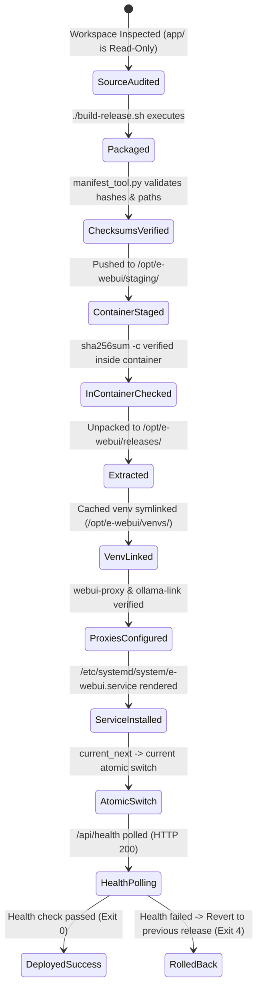

# Phase 1 Data Model: Build & Deployment Pipeline Audit

**Feature**: `020-build-deploy-pipeline-audit`  
**Date**: 2026-11-15  
**Status**: Completed  

## 1. Entities

### Entity 1: `ReleaseArtifact`
The immutable release package generated by `./build-release.sh`.

| Component | Path | Description | Verification Method |
|-----------|------|-------------|---------------------|
| `manifest.json` | `<release_dir>/manifest.json` | JSON Schema v1.0.0 metadata document describing version, commit, target OS, and file hashes | Schema validation via `manifest_tool.py validate-manifest` |
| `checksums.sha256` | `<release_dir>/checksums.sha256` | SHA-256 digests for all files in `payload/` | Verification via `sha256sum -c` |
| `app.tar.gz` | `<release_dir>/payload/app.tar.gz` | Gzip compressed tarball of the `app/` directory | Path safety audit via `manifest_tool.py verify-archive` |
| `requirements.txt` | `<release_dir>/payload/requirements.txt` | Snapshot of Python package requirements | Checked against `requirements.txt` hash |
| `e-webui.service` | `<release_dir>/payload/systemd/e-webui.service` | Systemd service unit template | Syntax and path verification |

---

### Entity 2: `ContainerDeploymentLayout`
The filesystem structure established inside the `e-webui-app` container under `/opt/e-webui`.

```text
/opt/e-webui/
├── current -> releases/<active-release-id>   # Atomic symlink to active release
├── current_next                             # Temporary switch staging symlink
├── deployment.env                           # Persistent deployment environment variables
├── .deploy_state                            # Machine-readable deployment metadata
├── .deploy.lock                             # Exclusive deployment flock
├── releases/                                # Immutable release directories
│   ├── <release-id-1>/
│   │   ├── app/                             # Extracted application source code
│   │   ├── requirements.txt                 # Pinned requirements snapshot
│   │   ├── manifest.json                    # Release manifest
│   │   ├── checksums.sha256                 # Cryptographic verification hashes
│   │   ├── venv -> /opt/e-webui/venvs/<hash> # Symlink to cached virtual environment
│   │   └── data -> /opt/e-webui/shared/data  # Symlink to persistent storage
│   └── <release-id-2>/
├── staging/                                 # Ephemeral package transfer staging
├── venvs/                                   # Hash-cached Python virtual environments
│   └── py3.11-<req-sha256>/
│       ├── bin/python3
│       └── bin/uvicorn
└── shared/                                  # Persistent state preserved across releases
    ├── data/
    └── models/
        └── kokoro/                          # Kokoro-82M TTS weights & voices
```

---

### Entity 3: `IncusProxyDeviceConfig`
Network proxy devices attached to the Incus container.

| Device Name | Type | Host Endpoint | Container Endpoint | Description |
|-------------|------|---------------|--------------------|-------------|
| `webui-proxy` | `proxy` | `127.0.0.1:<host_port>` (default 8080) | `127.0.0.1:8080` | Maps host browser traffic to container Uvicorn server |
| `ollama-link` | `proxy` | Target Ollama host (default `127.0.0.1:11434`) | `127.0.0.1:11434` (instance bind) | Transparently routes container Ollama requests to host Ollama |

---

## 2. Release & Deployment State Transitions


