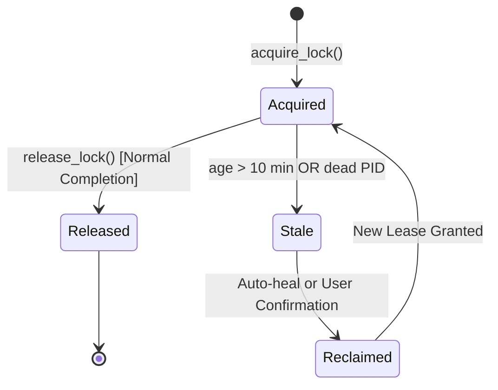

# Data Model: Interactive Deployment & Script Modernization Overhaul

**Feature**: Interactive Deployment & Script Modernization Overhaul  
**Date**: 2026-11-20  
**Status**: Completed  

---

### Entity 1: DeploymentState

Represents the persistent record stored inside the container at `/opt/e-webui/.deploy_state` tracking deployment history, active release, and configuration.

| Field | Type | Description | Validation |
| :--- | :--- | :--- | :--- |
| `schema_version` | String | Version of the deployment state schema (e.g. `"1.1.0"`) | Required |
| `container_name` | String | Name of the Incus container | Alphanumeric, hyphens |
| `active_release_id` | String | Active timestamp-based release identifier (e.g. `"20261120-120000"`) | Non-empty |
| `active_version` | String | Application semantic version (e.g. `"1.0.0"`) | Semantic versioning |
| `git_commit` | String | Commit hash of the deployed code | SHA-1 or `"none"` |
| `active_venv_hash` | String | SHA-256 hash of `requirements.txt` | 64-char hex string |
| `host_port` | Integer | Port bound on the host system via proxy | 1024 - 65535 (default 8080) |
| `container_port` | Integer | Port listened to by Uvicorn inside the container | Always 8080 |
| `ollama_target` | String | Address and port of upstream Ollama instance | Valid `host:port` string |
| `profile` | String | Active deployment profile | `"core"` or `"tts"` |
| `installed_at` | String | ISO 8601 UTC timestamp of last activation | ISO 8601 format |
| `status` | String | Lifecycle state of current deployment | `"HEALTHY"`, `"DEGRADED"`, `"MIGRATED"` |
| `history` | List[Dict] | Chronological record of recent healthy releases | Up to retention limit (default 3) |

---

### Entity 2: DeploymentLock

Represents the concurrency lease file stored inside the container at `/opt/e-webui/.deploy.lock/info`.

| Field | Type | Description | Validation |
| :--- | :--- | :--- | :--- |
| `pid` | Integer | Process ID of the deployment process on host | Valid positive integer |
| `time` | String | ISO 8601 UTC timestamp when lock was acquired | Valid datetime |
| `user` | String | OS username executing deployment | Non-empty string |
| `host` | String | Hostname of the deploying machine | Alphanumeric string |
| `operation` | String | Active operation name (e.g. `"update"`, `"install"`) | Valid operation enum |

**State Transitions & Expiration**:


---

### Entity 3: DeploymentProfile

Defines runtime resource boundaries and package dependencies.

| Profile Name | RAM Footprint | PyTorch / GPU Deps | HuggingFace Model | Target Use Case |
| :--- | :--- | :--- | :--- | :--- |
| **`core`** (Default) | ~40 MB | None | None | Fast, robust, offline-first chat interface with Ollama |
| **`tts`** (Add-on) | ~350 MB - 1 GB | PyTorch (CPU) + Soundfile + Kokoro | Kokoro-82M (~350 MB) | Speech synthesis & Read Aloud capability |

---

### Entity 4: IncusProxyMapping

Defines the isolated network forwarding rules between host, container, and upstream Ollama.

| Proxy Device | Listen Address (Source) | Connect Address (Destination) | Purpose |
| :--- | :--- | :--- | :--- |
| `webui-proxy` | Host `127.0.0.1:${HOST_PORT}` | Container `127.0.0.1:8080` | Host browser access to chat UI |
| `ollama-link` | Container `127.0.0.1:11434` | Target `${OLLAMA_TARGET}` | Container communication with Ollama |

---

### Entity 5: ReleaseManifest

Format of `manifest.json` embedded in each immutable release package.

```json
{
  "manifest_version": "1.0.0",
  "release_id": "20261120-034500-1a608b72",
  "version": "1.0.0",
  "created_at": "2026-11-20T03:45:00Z",
  "git": {
    "commit": "1a608b72e519...",
    "branch": "main",
    "dirty": false
  },
  "payload": {
    "archive": "app.tar.gz",
    "requirements": "requirements.txt",
    "systemd_unit": "systemd/e-webui.service"
  },
  "profile": "core",
  "checksums": {
    "sha256": "checksums.sha256"
  }
}
```
